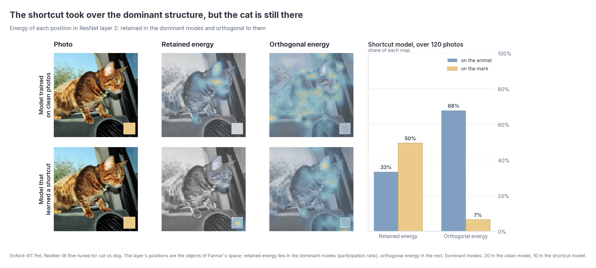
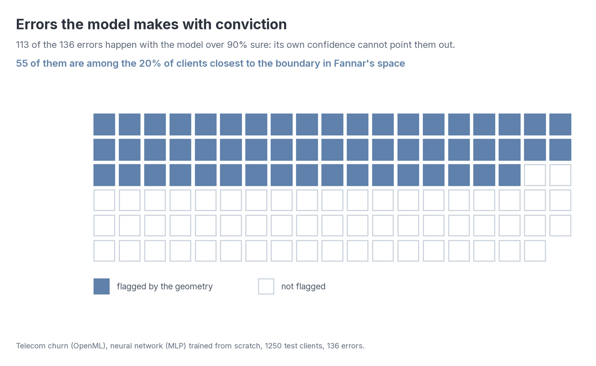
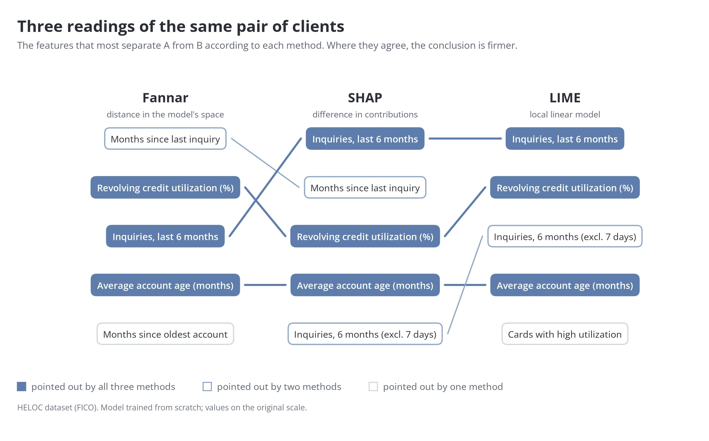
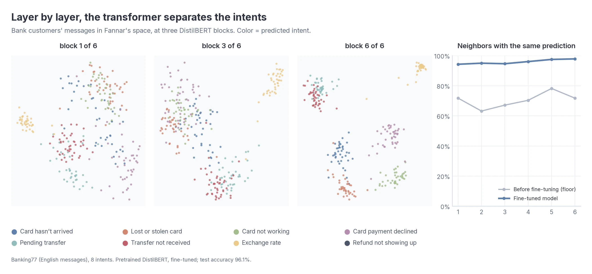
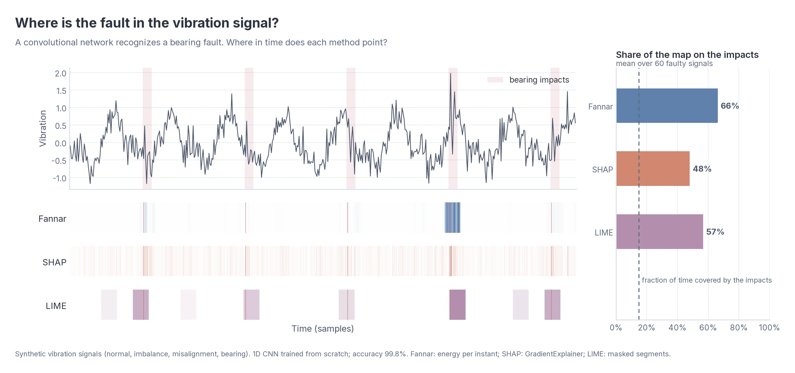

# Fannar

[![CC BY-NC 4.0][cc-by-nc-shield]][cc-by-nc]

Representation spaces of trained models from Gram matrices of several sources of information: one
positive-definite *kernel* per source, admissible transformations, Hadamard composition, and the
geometry and spectral energy of the resulting matrix.

**Fannar** is the name of the method, and this library is its implementation. Both are described
in the paper *Building Spaces via Similarity Tensors in Reproducing Kernel Hilbert Spaces: A
Mechanistic Interpretability Method*.

Documentation: **[fannar.fernandocsdm.com/docs](https://fannar.fernandocsdm.com/docs/)**.

```bash
pip install fannar               # core: numpy + matplotlib
pip install "fannar[all]"        # + PyTorch, scikit-learn and pandas
pip install -e ".[test]"         # from this directory, for development
```

## What it shows

<p align="center">
  
</p>

A ResNet-18 trained with a small mark on 95% of the dog photos learns the shortcut: it calls 40%
of the marked cats dogs. In that model, half of Fannar's energy map falls on the mark, which
covers 2% of the image. In the clean model, 91% falls on the animal.

<table>
  <tr>
    <td width="50%"></td>
    <td width="50%"></td>
  </tr>
  <tr>
    <td><b>Retained vs. orthogonal energy.</b> The shortcut takes the dominant modes, but the cat is still represented outside them: 68% of the orthogonal energy sits on the animal.</td>
    <td><b>Confident errors.</b> 113 of the 136 errors of a churn network come with more than 90% confidence. The geometric margin flags 55 of them.</td>
  </tr>
  <tr>
    <td></td>
    <td></td>
  </tr>
  <tr>
    <td><b>Pair explanations (XGBoost).</b> What separates a rejected applicant from a similar approved one. Where Fannar, SHAP and LIME agree, the conclusion is firmer.</td>
    <td><b>Transformers.</b> Customer intents separating block by block in a fine-tuned DistilBERT, against the same model before fine-tuning.</td>
  </tr>
</table>

<p align="center">
  
</p>

In time series, the per-instant energy of a 1D CNN concentrates on the impacts of a bearing fault:
66% of the map falls on them, and they cover 15% of the time.

> These examples come from models trained to illustrate the method, one run each. The systematic
> evaluation is in the paper. More case studies, and the interpretability service, at
> [fannar.fernandocsdm.com](https://fannar.fernandocsdm.com).

## The idea in one line

```
G = T( T_1(K_1) ∘ T_2(K_2) ∘ … ∘ T_d(K_d) )
```

`K_l` is the raw Gram matrix of source `l` (from a *kernel*, or one you supply), `T_l` the
component transform, `∘` the Hadamard product and `T` the final transform. By the Schur product
theorem, `G` is positive semidefinite for any such choice. It therefore defines a geometry
(distances, neighbourhoods, level sets) and a spectral decomposition of energy.

The library keeps two things apart, as the paper does:

* **the method**: the construction above and the readings on `G` (`KernelPipeline`, `GramSpace`);
* **the instantiation**: which objects, which sources, which *kernels* and transformations
  (`TorchSources`, `TreeSources`, or a function of yours).

## Quick start: a PyTorch model

```python
import copy
import fannar as fa

initial = copy.deepcopy(model)        # keep it before training: it is the floor of the readings
# ... train `model` ...

interp = fa.Interpreter(
    model, X_test, y_test,            # the trained model and the objects to interpret
    layers=["layer1", "layer2", "layer3"],   # names from model.named_modules()
    reference_model=initial,          # optional: the floor (the same network at initialisation)
    feature_names=names,              # optional: for the pair explanations
)

report = interp.evaluate()            # readings per layer: joint, baselines and floor
print(report.to_markdown())           # also: report.to_frame(), report.to_json("r.json")

interp.plot_report(report)            # readings × layers
interp.plot_embedding()               # each layer's space in its two dominant modes
interp.plot_gram("layer2")            # components, Hadamard product and final Gram
interp.plot_spectrum("layer2")        # eigenvalues and participation rank

expl = interp.explain_pair(0)         # why does object 0 differ from its nearest neighbour
expl.top(5)                           #   with another prediction? [(feature, x_i, x_j, share)]
expl.plot()                           # each feature's share, layer by layer
interp.swap_test(50)                  # swap validation: method × |Δx| × random

emap = interp.energy_map(image, "layer2")   # CNN: retained energy at each position of the image
```

By default each layer provides three sources, as in the paper:

| source | what it is |
|---|---|
| `activations` | the layer's output, pooled to a common grid of positions |
| `gradients` | the derivative of the contrastive margin `f_c − mean(f_{c'≠c})` with respect to that output |
| `parameters` | the filters the object activated, `p[:, s] = Σ_c A[c, s] W[c, :]` |

The default pipeline is `"paper"`: a linear *kernel*, `(T_a(K) + J)/2` on each component, the
Hadamard product, and `T_tr ∘ T_c`.

### Two safeguards built into the code

* **Gradient target.** With `target="predicted"`, the gradient carries the prediction itself, and
  readings about the decision become circular. The default is `target="fixed"` (class
  `fixed_class` for every object).
* **Floor.** Every reading needs a reference. Pass `reference_model` (the same architecture with
  its initial weights). The report measures that network's geometry against the trained network's
  behaviour, so the only difference between a reading and its floor is training.

## One module per kind of data

Since 0.4.0, each kind of data has its own entry point. Each one is an `Interpreter` with suitable
defaults and the same methods, and gives the same numbers as `fa.Interpreter` with the same
options. The modules load on first access, so `import fannar` stays light.

```python
import fannar as fa

fa.tabular.TabularInterpreter(model, df_test, y_test, layers=[...])  # PyTorch on tables; the DataFrame gives the names
fa.image.ImageInterpreter(cnn, loader, y_test, layers=[...])         # CNN/ViT, (N, C, H, W) outputs, grid=4
fa.text.TextInterpreter(fa.text.wrap_hf(hf_model, pad_token_id=0), input_ids, y)  # transformers over tokens
fa.tree.TreeInterpreter(tree, df_test, y_test, X_train=df_train)     # scikit-learn tree, slack in standard deviations
```

| module | for | what it adds |
|---|---|---|
| `fannar.tabular` | PyTorch models over rows of features | takes a `DataFrame`/`Series`: feature and class names |
| `fannar.image` | CNNs and ViTs | `grid=4`, `DataLoader` input, energy maps per position |
| `fannar.text` | transformers over token sequences | `layout="tokens"`, `grid=8`, `wrap_hf`, layers = encoder blocks |
| `fannar.tree` | scikit-learn decision trees | slack scale from `X_train`, labels of any type |

## Examples

They all run offline in seconds, on datasets that ship with scikit-learn or on synthetic data
(`pip install "fannar[all]"`, then `python examples/<script>.py`):

| script | module | what it shows |
|---|---|---|
| [`quickstart_digits.py`](examples/quickstart_digits.py) | `fannar.tabular` | the full tour: report, plots, pairs, swap test |
| [`tabular_wine.py`](examples/tabular_wine.py) | `fannar.tabular` | `DataFrame` and categorical labels, pairs and errors |
| [`tree_wine.py`](examples/tree_wine.py) | `fannar.tree` | depths as layers, text labels, a tree as the floor |
| [`image_digits_cnn.py`](examples/image_digits_cnn.py) | `fannar.image` | `DataLoader` input, energy map of one image |
| [`text_keywords.py`](examples/text_keywords.py) | `fannar.text` | `wrap_hf`, automatic layers, energy per token in each block |
| [`custom_gram.py`](examples/custom_gram.py) | `fannar` | your own sources, kernels and Gram matrices, no model |

## Your own Gram matrix

Any component can come from a *kernel* of yours, a transform of yours, or a matrix you have
already computed:

```python
pipe = fa.KernelPipeline(
    {
        "state":  fa.Component(fa.Linear(), fa.angular() >> fa.shift(1.0)),
        "text":   fa.Component(fa.RBF(gamma=0.1), fa.identity),
        "mine":   fa.Component(lambda A, B: (A @ B.T + 1) ** 2),     # any function k(X, Y)
    },
    final=fa.center >> fa.trace_normalize,
)
space = pipe(sources={"state": S, "text": T, "mine": M}, labels=y)
space = pipe(grams={"state": K1, "text": K2, "mine": K3})           # ready-made matrices
space = fa.GramSpace(my_psd_matrix, labels=y)                      # or a G of your own, directly
```

Available transforms (they compose with `>>`, left to right): `identity`, `center`,
`trace_normalize`, `frobenius_normalize`, `max_eig_normalize`, `angular()`, `shift(c)`,
`whiten()`, `spectral(f)`, `psd_project()`. *Kernels*: `Linear`, `Cosine`, `RBF`, `Polynomial`,
`FunctionKernel`. *Presets*: `fa.paper_pipeline()`, `fa.single_source("activations")`,
`fa.positions_pipeline()`.

> With Gaussian *kernels*, the Hadamard product becomes exactly a sum of the sources' metrics (the
> product of Gaussians is the Gaussian of the sum of the exponents). To keep the multiplicative
> interaction between sources, prefer `Linear`/`Cosine`.

## The representation space (`GramSpace`)

```python
space.distances               # pseudometric d(i,j)² = G_ii + G_jj − 2 G_ij
space.neighbors(i, k)         # k nearest neighbours
space.level_band(i, r, delta) # level band Γ_{r,δ}(i)
space.equivalence_classes()   # objects this space cannot tell apart
space.participation_rank()    # (tr G)² / ‖G‖²_F, without a spectral decomposition
space.energies()              # E_∥, E_⊥ and E_ratio per object
space.containment(labels)     # class directions inside V_r (r = K − 1)
space.embedding(2)            # coordinates in the two dominant modes (kernel PCA)
space.cka(other)              # centred alignment
space.decompose(K)            # G = a·K + R: what K explains, and the residual
```

## Other models

```python
# scikit-learn decision tree: path, slack and class distribution per depth
interp = fa.Interpreter(tree, X_test, y_test)          # or fa.tree.TreeInterpreter, above

# any model: a function returning {layer: {source: array}} and the predictions
def sources(X):
    return {"output": {"proba": model.predict_proba(X), "leaves": model.apply(X)}}, model.predict(X)

interp = fa.Interpreter(model, X_test, y_test, extractor=sources,
                        pipeline=fa.KernelPipeline(["proba", "leaves"]), baselines={})
```

## Report readings

| reading | question |
|---|---|
| `knn_prediction` | do an object's neighbours share its prediction? |
| `correctness_auc` | does the geometric margin anticipate where the model errs? |
| `confusion_agreement` | are the classes the model confuses close to each other? (≥ 5 classes) |
| `containment` | are the class directions inside the retained subspace? |
| `e_ratio_error_auc` | does the energy outside the retained subspace flag the errors? |

## Cost

Per Gram matrix, `Θ(n²D + n³)` with the full spectral decomposition (`n` objects, `D` the total
dimension of the sources). The participation rank takes `Θ(n²)`. A pair explanation costs one
forward and one backward pass over `F + 2` rows, linear in the number of features `F`.

## Tests

```bash
pip install -e ".[test]" && pytest
```

## Documentation

The documentation site lives in `docs/lib/` (Markdown, MkDocs Material), and the API reference is
generated from the docstrings. It is published at `fannar.fernandocsdm.com/docs` by the portfolio
project, which serves the static files:

```bash
pip install -e ".[docs]"
mkdocs serve                        # preview at http://127.0.0.1:8000/docs/
bash scripts/publish_docs.sh        # build and copy to ../Portfolio/public/fannar/docs
```

Then commit and deploy the portfolio.

## License

This work is licensed under a
[Creative Commons Attribution-NonCommercial 4.0 International License][cc-by-nc].

[![CC BY-NC 4.0][cc-by-nc-image]][cc-by-nc]

The full text is in [`LICENCE`](https://github.com/FernandoCsm-Knight/Fannar/blob/main/LICENCE). For
commercial use of the method, see the interpretability service at
[fannar.fernandocsdm.com](https://fannar.fernandocsdm.com).

[cc-by-nc]: https://creativecommons.org/licenses/by-nc/4.0/
[cc-by-nc-image]: https://licensebuttons.net/l/by-nc/4.0/88x31.png
[cc-by-nc-shield]: https://img.shields.io/badge/License-CC%20BY--NC%204.0-lightgrey.svg
