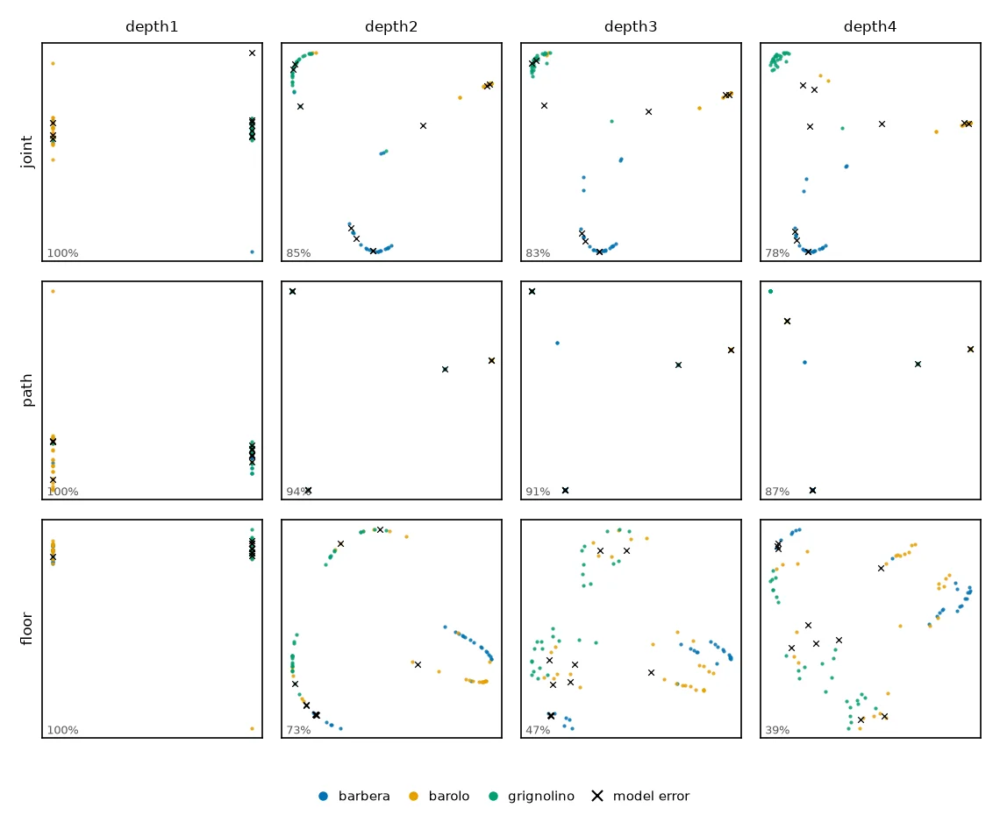
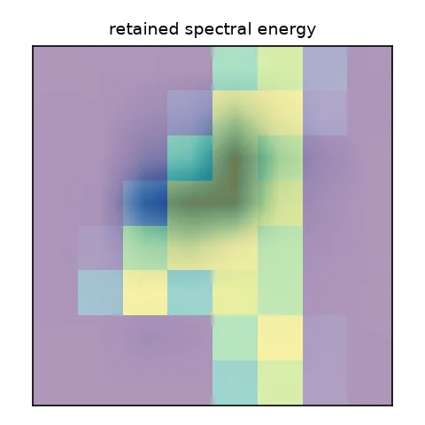

# Examples

Every script below runs offline in a few seconds on a CPU. They use datasets that ship with
scikit-learn, or synthetic data, so nothing is downloaded. The outputs shown are what each script
prints with the seeds it sets. Your numbers may differ slightly across PyTorch versions.

```bash
pip install "fannar[all]"
git clone https://github.com/FernandoCsm-Knight/Fannar.git && cd Fannar/examples
python tabular_wine.py
```

| script | module | model and data | what it shows |
|---|---|---|---|
| [`quickstart_digits.py`][quickstart] | `fannar.tabular` | MLP, `digits` as 64 features | the full tour: report, plots, pairs, swap test |
| [`tabular_wine.py`][tabular] | `fannar.tabular` | MLP, `wine` as a `DataFrame` | pandas input, named classes, pairs, errors |
| [`tree_wine.py`][tree] | `fannar.tree` | decision tree, `wine`, text labels | depths as layers, slack scale, a tree as the floor |
| [`image_digits_cnn.py`][image] | `fannar.image` | CNN, `digits` as 8×8 images | `DataLoader` input, energy map of one image |
| [`text_keywords.py`][text] | `fannar.text` | small transformer, synthetic sentences | `wrap_hf`, automatic layers, energy per token |
| [`custom_gram.py`][custom] | `fannar` | no model | your own sources, kernels and Gram matrices |

[quickstart]: https://github.com/FernandoCsm-Knight/Fannar/blob/main/examples/quickstart_digits.py
[tabular]: https://github.com/FernandoCsm-Knight/Fannar/blob/main/examples/tabular_wine.py
[tree]: https://github.com/FernandoCsm-Knight/Fannar/blob/main/examples/tree_wine.py
[image]: https://github.com/FernandoCsm-Knight/Fannar/blob/main/examples/image_digits_cnn.py
[text]: https://github.com/FernandoCsm-Knight/Fannar/blob/main/examples/text_keywords.py
[custom]: https://github.com/FernandoCsm-Knight/Fannar/blob/main/examples/custom_gram.py

## A table, with pandas

`tabular_wine.py` trains a small MLP on the 13 chemical measurements of the `wine` dataset. It
passes the test `DataFrame` and a categorical `Series` straight to
[`TabularInterpreter`](guides/tabular.md):

```python
y = pd.Series(pd.Categorical.from_codes(data.target, ["barolo", "grignolino", "barbera"]))
...
interp = TabularInterpreter(model, X_te, y_te, layers=["block1", "block2"], reference_model=initial)
interp.feature_names[:4]   # ['alcohol', 'malic_acid', 'ash', 'alcalinity_of_ash']
interp.class_names         # ['barolo', 'grignolino', 'barbera']
```

The pair explanation says what separates a wine from the nearest one that the model puts in
another class. The values are in the standardised scale the model was trained on:

```text
par (0, 69): grignolino x barbera
  alcohol                        i = -1.08  j = +0.72  parcela 54%
  color_intensity                i = -1.05  j = -0.26  parcela 14%
  flavanoids                     i = -0.28  j = -1.22  parcela 11%
```

`explain_errors` aggregates the same reading over the three test errors. Compare each feature's
share among the errors with its share in general. `ash` and `magnesium` weigh much more in the
mistakes (18% and 15%) than in the model's decisions overall (11% and 5%):

```text
  proline                        parcela nos erros 26% (em geral 25%), primeiro em 33%
  ash                            parcela nos erros 18% (em geral 11%), primeiro em 33%
  alcohol                        parcela nos erros 17% (em geral 16%), primeiro em 33%
  magnesium                      parcela nos erros 15% (em geral 5%), primeiro em 0%
```

The swap test checks the ranking. Each method orders the features, the features are swapped one
by one from $x_i$ to $x_j$, and a larger area means the prediction flips sooner. Here the
method's order beats both the size of the difference and a random order:

```text
{'method': 0.765, 'absdiff': 0.669, 'random': 0.296, 'pairs': 20, 'layer': 'block2'}
```

## The same table, with a tree

`tree_wine.py` fits a depth-4 `DecisionTreeClassifier` on the same data, with the labels as text.
[`TreeInterpreter`](guides/tree.md) maps them to `tree.classes_` (sorted:
`['barbera', 'barolo', 'grignolino']`). It uses the training standard deviation as the slack
scale, and a tree fitted on shuffled labels as the floor:

```python
shuffled = DecisionTreeClassifier(max_depth=4, random_state=0).fit(X_tr, rng.permutation(y_tr))
interp = TreeInterpreter(tree, X_te, y_te, X_train=X_tr, reference_model=shuffled)
```

<figure markdown="span">
  
  <figcaption>The space of each depth (columns) for the joint pipeline, the path alone and the
  floor. The classes come apart as the tree goes deeper. The path alone collapses every leaf to
  a point, so the slack is what spreads the objects inside a leaf. In the floor the classes stay
  mixed.</figcaption>
</figure>

The pair explanation can be read per depth. The root splits on `alcohol`, and from depth 2 on
the decision moves to `od280/od315_of_diluted_wines`:

```text
par (0, 83): grignolino x barbera
  od280/od315_of_diluted_wines   i =    2.57  j =    1.82  parcela 83%
  flavanoids                     i =    1.75  j =    0.48  parcela 17%
parcelas por profundidade (atributo principal): {'depth1': 'alcohol', 'depth2': 'od280/...', ...}
```

## Images, and where the energy sits

`image_digits_cnn.py` reads the 8×8 `digits` as images `(N, 1, 8, 8)` and trains a three-block CNN
(97% test accuracy). [`ImageInterpreter`](guides/image.md) receives the test `DataLoader` as it
is. Each block's output is pooled to a 4×4 grid, so `conv3` has 32 channels × 16 positions per
object.

For one image, `energy_map` uses the positions as the objects:

```python
emap = interp.energy_map(image, "conv2")                 # (8, 8)
interp.plot_energy_map(image, "conv2", image=image[0])
```

<figure markdown="span">
  { width="320" }
  <figcaption>Retained energy per position of <code>conv2</code> over a "1". The stroke covers
  36% of the image and holds 72% of the energy.</figcaption>
</figure>

## Text, layer by layer

`text_keywords.py` builds sentences of 8 to 16 tokens with padding. The class is a keyword placed
at a random position. The model mimics the Hugging Face interface (`model(input_ids=...,
attention_mask=...)` returns an object with `.logits`), so the script uses
[`wrap_hf`](guides/text.md) as it would with a real model. It does not pass `layers=`, so the
three encoder blocks are found automatically.

The per-token energy shows how the information moves through the network. In the first two
blocks the keyword is the token with the most energy. In the last block, attention has already
spread it over every token:

```text
frase 0: palavra-chave na posição 6 de 12; energia por token (normalizada):
  model.encoder.layer.0  [0.27 0.75 0.05 0.05 0.03 0.17 1.   0.32 0.31 0.07 0.05 0.55]
  model.encoder.layer.1  [0.22 0.55 0.16 0.06 0.03 0.21 1.   0.3  0.22 0.17 0.23 0.09]
  model.encoder.layer.2  [0.97 0.66 0.99 0.83 0.81 1.   0.99 0.97 0.92 0.95 0.94 0.91]

token de maior energia = palavra-chave (100 frases; ao acaso ~9%):
  model.encoder.layer.0  54%
  model.encoder.layer.1  66%
  model.encoder.layer.2  12%
```

!!! tip "Pick the layer for the question"
    Energy maps read the positions *inside one layer*. To see which tokens (or image regions)
    carry the information, look at the early and middle blocks. Near the output, attention and
    pooling have mixed the positions, and the map becomes uniform even when the model is right.
