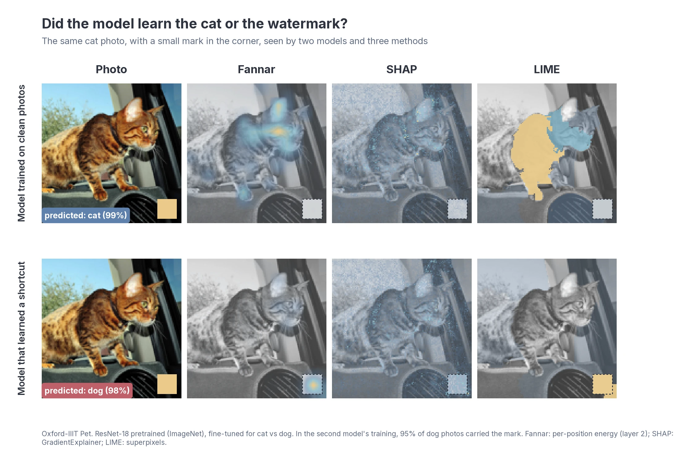
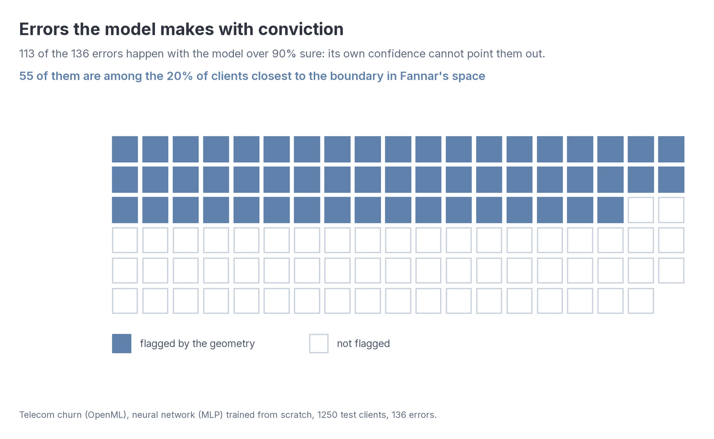
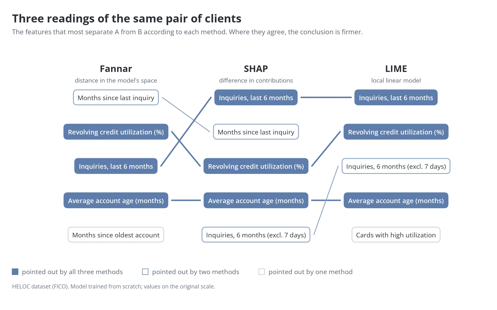

# Fannar

<p class="lead">
Representation spaces of trained models from Gram matrices of several sources: one
positive-definite kernel per source of information, admissible transformations, Hadamard
composition, and the geometry and spectral energy of the resulting matrix.
</p>

**Fannar** is the name of the method, and this library is its implementation. Both are described
in the paper *Building Spaces via Similarity Tensors in Reproducing Kernel Hilbert Spaces: A
Mechanistic Interpretability Method*.

```bash
pip install fannar            # core: numpy + matplotlib
pip install "fannar[all]"     # + PyTorch, scikit-learn and pandas
```

## The idea in one line

$$
G \;=\; T\big(\,T_1(K_1) \circ T_2(K_2) \circ \cdots \circ T_d(K_d)\,\big)
$$

$K_l$ is the raw Gram matrix of source $l$ (from a kernel, or one you supply), $T_l$ the
component transform, $\circ$ the Hadamard product and $T$ the final transform. By the Schur
product theorem, $G$ is positive semidefinite for any such choice, so it defines a geometry
(distances, neighbourhoods, level sets) and a spectral decomposition of energy. Everything Fannar
reports is read from $G$.

The library keeps apart, as the paper does:

- **the method**: the construction above and the readings on $G$
  ([`KernelPipeline`](reference/pipeline.md), [`GramSpace`](reference/space.md));
- **the instantiation**: which objects, which sources, which kernels and transformations
  ([`TorchSources`](reference/sources.md), [`TreeSources`](reference/sources.md), or a
  function of yours).

## What it shows

<figure markdown="span">
  
  <figcaption>A ResNet-18 trained with a small mark on 95% of the dog photos learns the shortcut
  and calls 40% of the marked cats dogs. In that model, half of Fannar's energy map falls on the
  mark, which covers 2% of the image; in the clean model, 91% falls on the animal.</figcaption>
</figure>

<div class="grid" markdown>

<figure markdown="span">
  
  <figcaption><strong>Confident errors.</strong> 113 of the 136 errors of a churn network come
  with more than 90% confidence; the geometric margin flags 55 of them.</figcaption>
</figure>

<figure markdown="span">
  
  <figcaption><strong>Pair explanations (XGBoost).</strong> What separates a rejected applicant
  from a similar approved one; where Fannar, SHAP and LIME agree, the conclusion is firmer.</figcaption>
</figure>

</div>

!!! note
    These examples come from models trained to illustrate the method, one run each; the
    systematic evaluation is in the paper. More case studies, and the interpretability service, at
    [fannar.fernandocsdm.com](https://fannar.fernandocsdm.com/).

## Where to go next

<div class="grid cards" markdown>

-   **Quick start**

    ---

    Interpret a PyTorch classifier layer by layer in a dozen lines.

    [:octicons-arrow-right-24: Quick start](quickstart.md)

-   **Examples**

    ---

    Runnable scripts for tables, trees, images and text, with the output they print.

    [:octicons-arrow-right-24: Examples](examples.md)

-   **By kind of data**

    ---

    `fannar.tabular`, `fannar.image`, `fannar.text` and `fannar.tree`: one entry point each.

    [:octicons-arrow-right-24: Choosing a module](guides/other-models.md)

-   **The method**

    ---

    Sources, kernels, admissible transforms, the Hadamard product, and why the floor matters.

    [:octicons-arrow-right-24: The method](concepts.md)

-   **Your own Gram matrices**

    ---

    Use the construction with any objects: your kernels, your transforms, your matrices.

    [:octicons-arrow-right-24: Custom pipelines](guides/custom-gram.md)

-   **API reference**

    ---

    Every public class and function, generated from the docstrings.

    [:octicons-arrow-right-24: API reference](reference/index.md)

</div>

## License

Fannar is released under the
[Creative Commons Attribution-NonCommercial 4.0 International License](https://creativecommons.org/licenses/by-nc/4.0/).
For commercial use of the method, see the interpretability service at
[fannar.fernandocsdm.com](https://fannar.fernandocsdm.com/).
